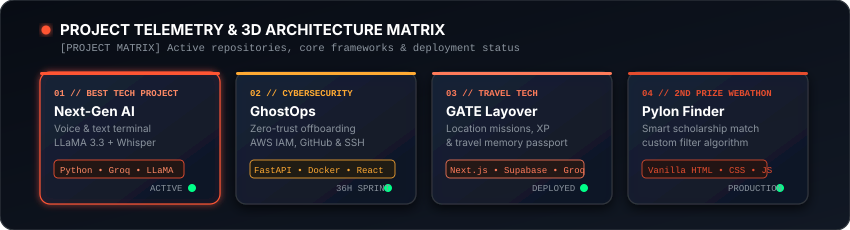
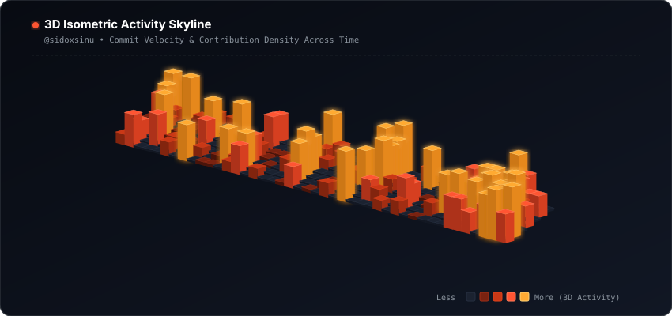
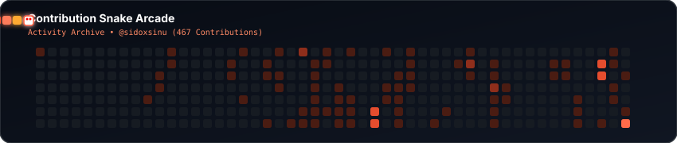
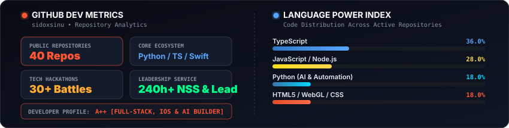

<!--
  ====================================================================
  MUHAMMED SINAN M (@sidoxsinu) — CYBER EMBER 3D PROFILE README
  ====================================================================
-->

<div align="center">

  <!-- HUD STATUS BAR & TOP BADGES (Single Balanced Row, Flat-Square Dark Theme) -->
  <p align="center">
    <a href="https://komarev.com/ghpvc/?username=sidoxsinu"></a>
    <a href="https://muhammedsinan.in" target="_blank"></a>
    <a href="https://linkedin.com/in/sidoxsinu" target="_blank"></a>
    <a href="https://twitter.com/sidoxsinu" target="_blank"></a>
    <a href="mailto:muhammedsinan.m67@gmail.com"></a>
  </p>

  <!-- 3D ANIMATED HERO BANNER (Crisp SVG, No Ghosting, Enhanced Contrast) -->
  <a href="https://muhammedsinan.in" target="_blank">
    
  </a>

  <!-- DYNAMIC TYPING TERMINAL -->
  <p align="center">
    <a href="https://muhammedsinan.in">
      
    </a>
  </p>

</div>

<!-- 3D DIVIDER -->
<p align="center"></p>

<!-- DEVELOPER TELEMETRY NEOFETCH CONSOLE -->
<div align="center">
  
</div>

<!-- 3D DIVIDER -->
<p align="center"></p>

<!-- ================================================================ -->
<!-- SECTION: 3D PROJECT MATRIX & INTERACTIVE TRACKER                 -->
<!-- ================================================================ -->

<h2 align="center">3D Project Radar &amp; Architecture Matrix</h2>

<p align="center">
  <i>Curated tracking of featured deployments, autonomous agents, campus infrastructure &amp; full-stack systems.</i>
</p>

<!-- 3D Visual Radar Card -->
<p align="center">
  
</p>

<!-- FEATURED FLAGSHIP PROJECTS SHOWCASE (VERIFIED FROM OFFICIAL RESUME) -->
<table width="100%">
  <tr>
    <td width="50%" valign="top">
      <h3><a href="https://github.com/sidoxsinu/next-gen-ai-assistant-system">Next-Gen AI Assistant System</a></h3>
      <p><b>Domain:</b> Multi-Modal AI &bull; Autonomous Speech &amp; Text</p>
      <p>Multi-modal AI terminal for voice and text workflows using LLaMA 3.3 for responses and Whisper for speech-to-text with integrated tool calling.</p>
      <p>
        
      </p>
      <p>
        
        <a href="https://github.com/sidoxsinu/next-gen-ai-assistant-system"><b>[Code &rarr;]</b></a>
      </p>
    </td>
    <td width="50%" valign="top">
      <h3><a href="https://github.com/sidoxsinu">GhostOps Zero-Trust Offboarding</a></h3>
      <p><b>Domain:</b> Cybersecurity &bull; Cloud Infrastructure</p>
      <p>Zero-trust offboarding tool mapping and revoking developer credentials across AWS IAM, GitHub, and SSH from a single dashboard with Dockerized SSH environment.</p>
      <p>
        
      </p>
      <p>
        
      </p>
    </td>
  </tr>
  <tr>
    <td width="50%" valign="top">
      <h3><a href="https://github.com/sidoxsinu/LayoverHackathon">GATE &bull; Layover Companion</a></h3>
      <p><b>Domain:</b> Travel Tech &bull; Gamified Mobility</p>
      <p>Mobile-first app turning waiting time into location-based missions, with an XP rank system and a travel passport of photo memories. Built for LAYOVER hackathon.</p>
      <p>
        
      </p>
      <p>
        
        <a href="https://github.com/sidoxsinu/LayoverHackathon"><b>[Code &rarr;]</b></a>
      </p>
    </td>
    <td width="50%" valign="top">
      <h3><a href="https://github.com/sidoxsinu/Pylon">Pylon &bull; Smart Scholarship Finder</a></h3>
      <p><b>Domain:</b> EdTech Platform &bull; Algorithmic Matching</p>
      <p>Clean scholarship discovery platform with custom filtering algorithms and performance-tuned UI built with core vanilla web technologies.</p>
      <p>
        
      </p>
      <p>
        
        <a href="https://github.com/sidoxsinu/Pylon"><b>[Code &rarr;]</b></a>
      </p>
    </td>
  </tr>
  <tr>
    <td width="50%" valign="top">
      <h3><a href="https://github.com/sidoxsinu/Kiosk-1">Campus Compass Kiosk</a></h3>
      <p><b>Domain:</b> Campus IoT &bull; Interactive Wayfinding</p>
      <p>Interactive self-service touch kiosk built for Christ College of Engineering to explore campus facilities, buildings, and departmental wayfinding.</p>
      <p>
        
      </p>
      <p>
        
        <a href="https://github.com/sidoxsinu/Kiosk-1"><b>[Code &rarr;]</b></a>
      </p>
    </td>
    <td width="50%" valign="top">
      <h3><a href="https://github.com/sidoxsinu/BusCue">BusCue Transit Engine</a></h3>
      <p><b>Domain:</b> Real-time Telemetry &bull; Smart Mobility</p>
      <p>Campus and regional bus tracking engine designed to eliminate commuter uncertainty through live location telemetry and route tracking.</p>
      <p>
        
      </p>
      <p>
        
        <a href="https://github.com/sidoxsinu/BusCue"><b>[Code &rarr;]</b></a>
      </p>
    </td>
  </tr>
</table>

<br/>

<!-- MASTER PROJECT TELEMETRY MATRIX -->
<h3 align="center">Master Project Telemetry Matrix</h3>

| Project | Domain | Core Tech | Status / Recognition | Direct Access |
| :--- | :--- | :--- | :---: | :--- |
| **[Next-Gen AI Assistant](https://github.com/sidoxsinu/next-gen-ai-assistant-system)** | Multi-Modal AI | Python, Groq, LLaMA 3.3, Whisper | `Winner @ Google Build with AI` | [Repository &rarr;](https://github.com/sidoxsinu/next-gen-ai-assistant-system) |
| **[GhostOps](https://github.com/sidoxsinu)** | Cybersecurity | Python, FastAPI, Docker, AWS IAM, React | `36h Hackathon Sprint` | [Showcase &rarr;](https://github.com/sidoxsinu) |
| **[GATE Layover Companion](https://github.com/sidoxsinu/LayoverHackathon)** | Travel Tech | Next.js, Supabase, Groq API, Vercel | `LAYOVER Hackathon TinkerSpace` | [Repository &rarr;](https://github.com/sidoxsinu/LayoverHackathon) |
| **[Pylon Scholarship Finder](https://github.com/sidoxsinu/Pylon)** | EdTech Platform | Vanilla HTML5, CSS3, JavaScript | `2nd Prize, Webathon 2025` | [Repository &rarr;](https://github.com/sidoxsinu/Pylon) |
| **[Campus Compass Kiosk](https://github.com/sidoxsinu/Kiosk-1)** | Campus Navigation IoT | Interactive Kiosk UI | `Deployed @ Christ College` | [Repository &rarr;](https://github.com/sidoxsinu/Kiosk-1) |
| **[RuralReach](https://github.com/sidoxsinu/RuralReach)** | Gamified Learning | React, Node.js, Express, MongoDB | `Production Platform` | [Repository &rarr;](https://github.com/sidoxsinu/RuralReach) |
| **[CodeBurry](https://github.com/sidoxsinu/CodeBurry)** | Interactive CS Study | React, TypeScript, Tailwind CSS | `UI Complete &bull; In Progress` | [Repository &rarr;](https://github.com/sidoxsinu/CodeBurry) |
| **[MultiLinks](https://github.com/sidoxsinu/MultiLinks)** | Bio &amp; Profile Hub | TypeScript, Modern CSS, Vite | `Production Platform` | [Repository &rarr;](https://github.com/sidoxsinu/MultiLinks) |
| **[IEEE CCE LYNK](https://github.com/sidoxsinu/IEEE_CCE_LYNK)** | Student Community Portal | TypeScript, Component UI | `Production Deployment` | [Repository &rarr;](https://github.com/sidoxsinu/IEEE_CCE_LYNK) |
| **[BusCue](https://github.com/sidoxsinu/BusCue)** | Transit Telemetry | Geolocation, Web Telemetry | `Active Beta Testing` | [Repository &rarr;](https://github.com/sidoxsinu/BusCue) |

<br/>

<!-- COLLAPSIBLE: COMPLETE 40 REPOSITORIES DIRECTORY -->
<details>
  <summary><b>Click to expand complete 40-repository archive &amp; hackathon log</b></summary>
  <br/>

  > Synchronized repository catalog for **[@sidoxsinu](https://github.com/sidoxsinu)**:
  >
  > - `Agentic-Ai` &bull; Autonomous agent architecture research (Python)
  > - `AI-Voice-Assistant` &bull; Voice-driven intelligent query assistant (HTML/JS)
  > - `AnyLearn` &bull; Next-gen adaptive learning platform (TypeScript)
  > - `BeachHack` &bull; Machine learning hackathon prototype (Jupyter)
  > - `BusCue` &bull; Smart transit and route optimization engine
  > - `Code-a-Pookalam` &bull; Algorithmic generative art in Python
  > - `CodeBurry` &bull; Active coding quest &amp; gamified challenges (React, TS)
  > - `files` &bull; Core computer science data structures &amp; algorithms (Java)
  > - `flashcard-quizzer-deploy` &bull; Interactive cognitive flashcard study app (JS)
  > - `Github-Enablment-Task` &bull; GitHub CI/CD automation &amp; developer tooling workflows
  > - `HackBattle26` &bull; Hackathon sprint project (JavaScript)
  > - `HackQuest25` &bull; 24-hour hackathon project (TypeScript)
  > - `IEEE_CCE_LYNK` &bull; IEEE CCE community engagement platform (TypeScript)
  > - `Kiosk-1` &bull; Interactive campus navigation kiosk system for CCE
  > - `LayoverHackathon` &bull; Real-time flight &amp; transit layover assistant (TypeScript)
  > - `movie-watchlist-deploy` &bull; Dynamic cinema tracking &amp; review watchlist (JavaScript)
  > - `muhammedsinanm` &bull; Personal developer portfolio codebase (TypeScript)
  > - `MultiLinks` &bull; Ultra-fast bio link &amp; digital identity aggregator (TypeScript)
  > - `next-gen-ai-assistant-system` &bull; Autonomous multi-agent AI assistant suite (Python, Groq, LLaMA)
  > - `Pylon` &bull; Zero-framework scholarship search platform (HTML/CSS/JS)
  > - `Robotics-Web` &bull; Telemetry dashboard for hardware &amp; robotics monitoring (JavaScript)
  > - `RuralReach` &bull; Gamified rural education platform with virtual gardens (MERN)
  > - `sidoxsinu` &bull; Special GitHub profile README repository
  > - `SilentGuard` &bull; Privacy and security monitoring scripts (Python)
  > - `survive-the-island-submissions` &bull; Game theory &amp; algorithmic survival simulation (Python)
  > - `Trend_Power` &bull; Market trend analytics &amp; visualization UI (HTML/CSS/JS)
  > - `university-hub` &bull; Unified academic resource repository for college students (JavaScript)
  > - `universityhub` &bull; Campus student portal &amp; notification feed (JavaScript)
  > - `VDash-main-2` &bull; Interactive analytical dashboard UI (HTML)
  > - `Workshop-Tracker` &bull; Tech workshop check-in tracker (JavaScript)

</details>

<!-- 3D DIVIDER -->
<p align="center"></p>

<!-- ================================================================ -->
<!-- SECTION: 3D ISOMETRIC ACTIVITY SKYLINE & SNAKE ARCADE            -->
<!-- ================================================================ -->

<h2 align="center">3D Isometric Activity Skyline</h2>

<p align="center">
  <i>Isometric 3D projection of commit velocity and contribution density across time.</i>
</p>

<!-- 3D ISOMETRIC CONTRIBUTION SKYLINE (Centered & Balanced) -->
<p align="center">
  <a href="https://github.com/sidoxsinu">
    
  </a>
</p>

<!-- SNAKE ARCADE -->
<h3 align="center">Contribution Snake Arcade</h3>

<p align="center">
  
</p>

<!-- 3D DIVIDER -->
<p align="center"></p>

<!-- ================================================================ -->
<!-- SECTION: TELEMETRY & GITHUB PERFORMANCE METRICS                  -->
<!-- ================================================================ -->

<h2 align="center">Developer Telemetry &amp; Performance HUD</h2>

<!-- 3D METRICS + LANGUAGE INDEX (Zero Collisions, Perfectly Spaced) -->
<p align="center">
  
</p>

<!-- STREAK STATS -->
<p align="center">
  <a href="https://github.com/sidoxsinu">
    
  </a>
</p>

<!-- 3D DIVIDER -->
<p align="center"></p>

<!-- ================================================================ -->
<!-- SECTION: TECHNICAL SKILLS & BATTLE ARSENAL (FROM RESUME)         -->
<!-- ================================================================ -->

<h2 align="center">Technical Skills &amp; Battle Arsenal</h2>

<p align="center">
  <i>Languages, runtimes, AI models, cloud databases, and development tooling.</i>
</p>

<table width="100%">
  <tr>
    <td width="50%" valign="top">
      <h4>Core Languages &amp; Mobile</h4>
      <p>
        
        
        
        
        
        
        
      </p>
    </td>
    <td width="50%" valign="top">
      <h4>Frontend, Mobile &amp; Motion</h4>
      <p>
        
        
        
        
        
        
        
      </p>
    </td>
  </tr>
  <tr>
    <td width="50%" valign="top">
      <h4>Backend, APIs &amp; AI Stack</h4>
      <p>
        
        
        
        
        
        
        
        
      </p>
    </td>
    <td width="50%" valign="top">
      <h4>Databases, DevOps &amp; Practices</h4>
      <p>
        
        
        
        
        
        
        
        
      </p>
    </td>
  </tr>
</table>

<!-- 3D DIVIDER -->
<p align="center"></p>

<!-- ================================================================ -->
<!-- SECTION: LEADERSHIP, ACHIEVEMENTS & DOSSIER (VERIFIED)           -->
<!-- ================================================================ -->

<h2 align="center">Leadership &amp; Community Dossier</h2>

<details>
  <summary><b>IEEE Kerala Section (100+ Student Branches)</b></summary>
  <br/>

  - **Design Lead, Kerala EDS/CT/Nano Joint Chapter:** Leading visual identity, branding, and technical engagement across student chapters statewide.
  - **Webmaster, IAS and Computer Society Chapters:** Managing digital infrastructure, event portals, and chapter online presence.
  - **Student Branch Web and Design Team:** Driving frontend delivery and creative communications.
  - **IEEE Student Member:** Active across 7 societies.
</details>

<details>
  <summary><b>IEDC CCE &amp; TinkerHub CCE Leadership</b></summary>
  <br/>

  - **Co-Chief Financial Officer (Co-CFO) @ IEDC CCE (Jun 2026 - Present):** Managing institutional innovation budgets, startup incubation funding, and entrepreneurship grants.
  - **Resource Person for Converge AI Tool Workshop (Oct 2026):** Trained 25-30 students on generative AI tools, prompt workflows, and practical applications.
  - **Learning Coordinator @ TinkerHub CCE:** Coordinating and conducting technical events, hands-on learning sessions, and hackathons.
  - **Member:** Community of Developers (Aug 2025 - Present) and FOSS CCE (Dec 2025 - Present).
</details>

<details>
  <summary><b>Honors, Awards &amp; 30+ Hackathon Battles</b></summary>
  <br/>

  - **Best Technical Project:** Google for Developers Build with AI Hackathon (2026) for Next-Gen AI Assistant System.
  - **2nd Prize:** Webathon 2025 for Pylon Smart Scholarship Finder.
  - **Finalist:** BeachHack Season 7 (multi-stage competitive selection among 100+ participants).
  - **30+ Hackathons Competed:** Participated in technical sprints across top institutions including NIT, VIT, and RSET; presented a Medical SaaS product at Medex Concordium 2025.
  - **National Service Scheme (NSS):** Volunteer Leader (2023 - 2025) with 240+ certified hours of community development.
</details>

<details>
  <summary><b>Dev Lore: The Co-Pilot (Orange Kitten) &amp; Rig</b></summary>
  <br/>

  ```
          /\_/\  
         ( o.o )  <-- "Commit verified against resume. Ship it!"
          > ^ <   
  ```
  - **Name:** Classified (Code name: *Tangerine*)
  - **Role:** Chief Emotional Officer &amp; Keyboard Stepper
  - **Ambient Fuel:** `#E54D2E` keyboard backlight + Dark Mode everything
  - **Caffeine Level:** `[████████████████████] 99.8%`
</details>

<!-- 3D DIVIDER -->
<p align="center"></p>

<!-- ================================================================ -->
<!-- SECTION: HOLOGRAPHIC TRANSMISSION PORTAL (LET'S CONNECT)         -->
<!-- ================================================================ -->

<h2 align="center">Transmission Portal</h2>

<p align="center">
  <i>Open for remote SDE internships, hackathon collaborations &amp; high-impact engineering builds.</i>
</p>

<!-- UNIFIED CYBER EMBER DARK THEME BADGES (Single cohesive color scheme) -->
<p align="center">
  <a href="https://muhammedsinan.in" target="_blank">
    
  </a>
  &nbsp;
  <a href="https://linkedin.com/in/sidoxsinu" target="_blank">
    
  </a>
  &nbsp;
  <a href="https://twitter.com/sidoxsinu" target="_blank">
    
  </a>
  &nbsp;
  <a href="https://instagram.com/sidoxsinu" target="_blank">
    
  </a>
  &nbsp;
  <a href="mailto:muhammedsinan.m67@gmail.com">
    
  </a>
</p>

<br/>

<div align="center">
  <p>
    <i>"Constantly crafting, occasionally breaking, relentlessly shipping."</i>
    <br/>
    <b>Valanchery &bull; Irinjalakuda, Kerala, India &bull; Christ College of Engineering</b>
  </p>
</div>
